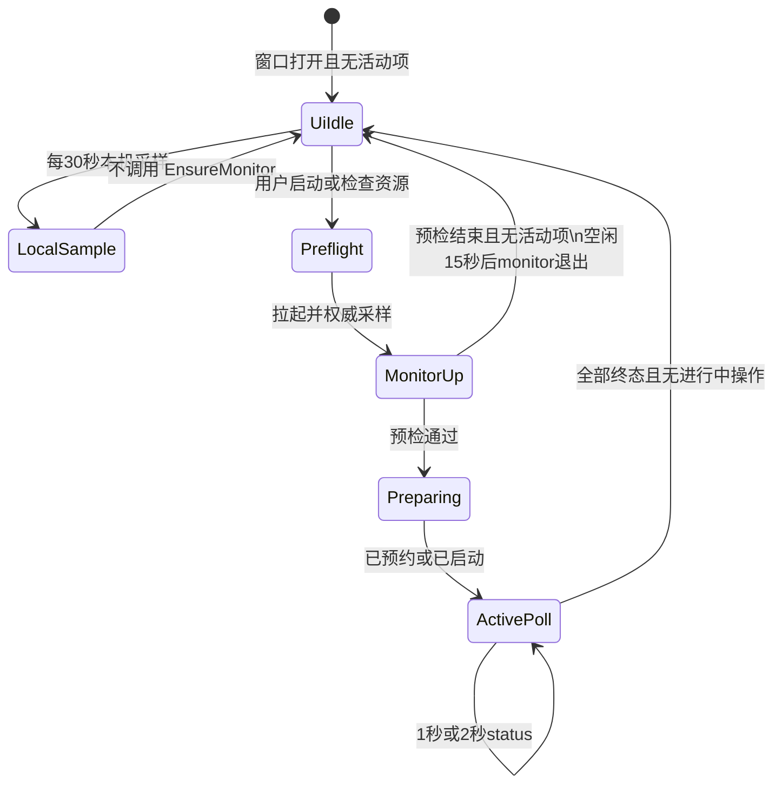
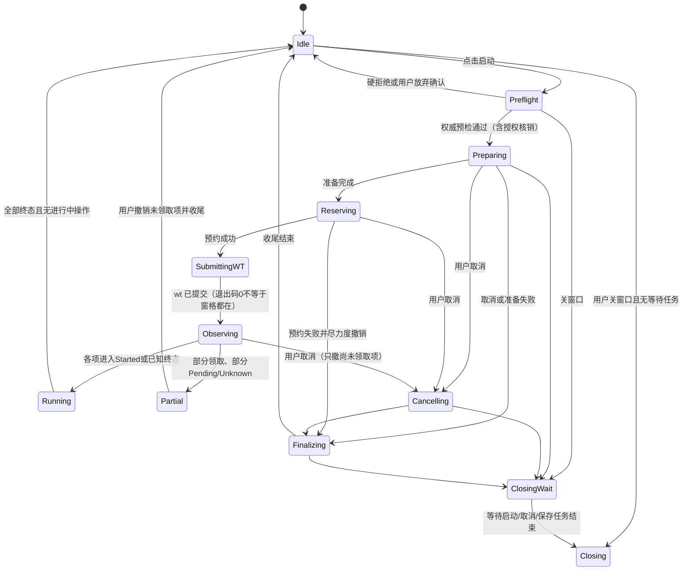

# 实用多窗格启动器设计规格

- 文档路径：`docs/superpowers/specs/2026-11-10-practical-multipane-design.md`
- 状态：**待用户审阅**。用户书面确认本规格前，不得编写实现计划以外的实现代码，不得改动产品源码。
- 基准代码：分支 `fix/review-corrections-20261110`，提交 `06e1e914424890947a55ae02c06711a12ba0aa62`（提交时间 2026-11-10 20:39:45 +08:00，即 America/Adak 2026-11-10 02:39）。
- 批准方向：默认「实用」资源模式；支持 1/2/4/8/16 分屏预设与逐窗格 Agent 混搭；保护可配置但不可关到零；不为 16 个真实 Agent 做压力测试。节约资源与「可启动」并列为核心目标：优先少启动、不空转、错开峰值，而不是只把门禁放宽到能点下去。
- 标注约定：凡标为**设计选择**的数字，是规格约定而非本轮基准测试或长期观测结果；凡标为**已观测**的数字，仅描述写规格时的瞬时环境或官方文档，不能外推为验收通过。

本规格取代此前口头方案中任何未写入本文的细节。若与现行代码冲突，以「目标行为」为准，并在兼容性节说明迁移。本文不声称零风险。

## 1. 需求、非目标与术语

### 1.1 要解决的问题

当前实现把每个 Agent 的 2 GiB **Job 提交上限**同时当作准入时的物理占用加总，再叠加约 3 GiB 系统预留和 `min(8 GiB, 物理内存的 35%)` 总预算。在约 16 GiB 内存的机器上，这会使 2 个及以上 Agent 经常无法启动，8/16 分屏在产品层也被死限为最多 4 项。用户需要：能配置并启动最多 16 个窗格、每个窗格独立选择 Agent，启动后的 Windows Terminal 窗格可辨认，同时电脑仍保持可操作。只放宽错误的 Job 上限加总并不能达到实用：未勾选的槽不得变成常驻进程，启动器与 monitor 不得在空闲时空转，也不得把 16 个可配置窗格宣传成 16 个已启动 Agent。

### 1.2 范围内需求

1. 分屏规模预设：1、2、4（2 列 2 行）、8（4 列 2 行）、16（4 列 4 行）。实际启动项等于勾选的槽，不得为未勾选的槽制造空窗格。
2. 每个槽的 Agent、工作目录、启动参数相互独立，允许混搭；提供「将此项 Agent 应用到后续/全部窗格」的填充，且不得覆盖目录、备注等无关字段。
3. 更改规模不得静默丢弃已编辑槽；旧的 4 槽配置与模板必须能加载。
4. UI、预览、拖放、monitor 预约、合同文档的上限一致为 16。
5. 网格分割尺寸与焦点顺序必须可验证；任意勾选数量（1 到 16）都有确定排布。
6. Terminal 美化仅限：标题（序号、Agent、目录）、已有内置深色配色、标签色；高对比度不覆盖配色；不写用户 `settings.json`、fragment 或新建 profile；不承诺 CLI 字体与间距。
7. 资源模式：保守 / 实用 / 自定义，默认实用。预检结果可见。仅当硬保护通过、仅超出保守软预算时，才允许明确确认后继续。配置窗口与 monitor 必须使用同一决策函数，确认必须由 monitor 权威校验。
8. Job 内存上限可配置，默认仍为 2 GiB；禁止按「可用内存 ÷ 16」把上限降到几百 MB。根 Job CPU 上限可配置，**默认保持 35%**（用户未批准提高默认值），界面展示该值。
9. 保留近期已修复的启动门禁、提交代次、取消与关闭收尾行为。
10. 测试验收覆盖模型、资源、持久化、monitor、WT 参数、轻量 16 进程可视验证、GUI，以及完整既有测试套件；禁止 16 个真实 Agent 压测；测试不得写入用户真实配置或项目目录。
11. 16 个可配置槽不等于 16 个常驻 Agent。未勾选槽只占配置，不创建窗格、不启动 Worker/Agent、不预约。不得把空窗格或尚未创建进程的项显示为「已启动」。界面需同时显示：已配置、已勾选、已预约、已启动进程。
12. 按第 7 节优先级落实可测的节约措施：自适应轮询、空闲时允许 monitor 退出、复用采样与未变化短帧、有界账本/日志、只为实际启动项准备 worktree、准备并发上限为 1、退出释放 Job 句柄。错峰启动与追加启动为 P1，必须成套交付否则整项不做。
13. 不同 Agent 的成本只展示有依据的信息（规划估算、Job 上限、是否需要独立 worktree）。没有实测基准时不得编造「某型号更省内存」。

### 1.3 非目标

- 不在本规格实现自动合并、自动删除 worktree、kill-on-close、结束用户其他程序。
- 不写 Windows Terminal 全局设置，不安装 settings fragment，不新建或改写用户 profile 来「绕路」设置字体、间距、padding。
- 不把 16 分屏等同于 16 个 Agent 内存充足，也不承诺 16 满载安全或线性加速。
- 不把 Job 内存上限当作「必然强杀整个 Job」。
- 不在本轮修改根 CPU 默认 35%，除非用户另批。
- 不做 16 个真实 CLI Agent 的压力、登录、对话或稳定性测试。
- 不引入第三方 NuGet、不改目标框架、不把 Core 项目接入磁盘或进程。
- 不扩大到多 GUI 写入者、跨用户会话或远程调度。
- 不为「更漂亮」增加 WebView、常驻渲染进程、周期性重绘 Agent 输出或拦截 Agent 输入。
- 不以暂停后台 Agent、自动强杀、静默降低 Job 上限或丢弃日志来换取账面节约。
- 不通过改写用户 Windows Terminal 全局设置去改 scrollback、字体或历史行数；CLI 无法设置则明确不承诺、不视为已实现。
- 不在本规格引入「先开空窗格、之后再往里面填 Agent」的占位协议。
- 不把错峰启动宣传成减少稳态内存。

### 1.4 术语

| 术语 | 含义 |
| --- | --- |
| 槽（Slot） | 配置中的一项 Agent 定义，可启用或停用。 |
| 启用项 | `Enabled == true` 的槽；启动批次只包含这些项。 |
| 规模预设 | UI 上的 1/2/4/8/16 快捷，用于补齐槽位、建议勾选和预览默认网格，不是删除已编辑槽的命令。 |
| 窗格（pane） | Windows Terminal 中一个实际打开的终端表面，对应一个启用项和一个 Worker `pane` 进程。 |
| Job 内存上限 | 写入 Win32 Job `JobMemoryLimit` 的**提交内存**上限，单位字节。默认 2 GiB。它限制该 Agent 及其受管子进程可提交的内存，不是当前物理占用。 |
| 规划估算（PlanningBytes） | 仅用于准入加总的估算值，设计选择，不是实测工作集。 |
| 硬保护 | 任何模式、任何确认都不能绕过的拦截条件。 |
| 软预算 | 保守模式下可经 monitor 签发的一次性确认后继续的条件；硬保护仍必须通过。 |
| 确认授权（waiver） | monitor 内存中的一次性、有有效期、绑定策略与计划摘要的许可，不是 UI 勾选布尔。 |
| 活动预约 | ledger 中尚未终态（非 Revoked/Settled/FailedBeforeStart）的记录，计入并发预算。 |
| 物理临界余量 | 启动后仍须保留的可用物理内存下限。 |
| 提交临界余量 | 启动后仍须保留的系统提交（commit）可用下限。 |
| 遗留记录 | 本规格实施前写入、缺少策略字段的 control.json 条目。 |
| 按需启动 | 只把已勾选槽变成窗格与进程；已配置未勾选的槽保持零运行时占用。 |
| 追加启动 | P1：对尚未运行的已勾选槽新开一个 Terminal 窗口与新预约，不拆入已有网格。 |
| 错峰启动 | P1：已预约窗格按延迟再创建 Agent 进程，只降峰值，不降稳态占用。 |
| 本机预览采样 | 界面空闲时在 App 进程内做的展示/预检采样；预约与 begin 仍以 monitor 采样为准。 |

## 2. 现行基线（实现时必须对照，不得误改）

以下为基准提交中的关键约束，目标行为若放宽上限或改准入，须同时改齐，避免 UI 放行而 monitor 拒绝。

- 槽位上限 4：`Draft.Validate`（`Models.cs` 约第 43 行）、添加/撤销移除、拖放最多 4 个文件夹、`Monitor` reserve 的 `items.Length is <1 or >4`（`Program.cs` 约第 221 行）、合同 `docs/CONTRACTS.md` 第 55 行「panes 1～4」。
- 准入与预算：`ResourcePolicy`（`Models.cs` 89–103 行）把 `AgentBudget = 2 GiB` 同时用于加总；系统预留 `max(3 GiB, Total/5)`；总预算 `min(8 GiB, Total*35/100)`；采样超过 3 秒或 CPU 非有限则拒绝。
- Job：`Native.cs` 第 90–91 行，根 Job CPU `Rate=3500` 且 `Flags=1|4`（启用 + 硬封顶 35%）；每项 Job `Flags=0x200`（`JOB_OBJECT_LIMIT_JOB_MEMORY`）+ `JobMemory=Plan.Budget`。
- Terminal：`Services.cs` `SubmitTerminal` 仅对 2 项等分和 4 项 2×2 有专用逻辑；`TerminalAppearance` 已设置标题、`--suppressApplicationTitle`、`--startingDirectory`、非高对比度下 `One Half Dark` 与统一标签色，并声明不写用户设置。
- 门禁与收尾：`submissionGeneration`、关闭等待 `launchTask`/`cancelTask`、路径 Enter、收尾文案区分，均须保留。

### 2.1 写规格时的本机瞬时环境（已观测，非验收）

2026-11-10 12:46:36Z（America/Adak 2026-11-10 02:46）只读采样：XIAOMI REDMI Book 16 2025，Windows 11 10.0.26200，物理内存 16 312 639 488 字节（约 15.19 GiB），当时可用约 5.83 GiB，提交空间约 33.82 GiB（可用约 15.98 GiB），Ryzen 7 7735H、8 核 16 线程，Windows Terminal 1.24.12741.0。这些数字会随占用变化，只用于说明为何现行加总会在本机上把 2 开也拦住，以及下文硬保护如何工作。

## 3. 分屏规模、槽位与布局

### 3.1 上限与预设

- 槽数与单次启用项、单次 reserve 的 Agent 项、拖放文件夹数的上限均为 **16**。Git 准备仍为全局 1 个并发，不占用这 16 个窗格名额，但其 Job 与规划估算计入资源。
- 规模预设：

| 预设 | 网格 | 说明 |
| --- | --- | --- |
| 1 | 1×1 | 单项，不分割 |
| 2 | 由「两项布局」决定 | `vertical`：左右等分（`-V`）；`horizontal`：上下等分（`-H`）。两项布局控件仅在启用数为 2 时有效，与现行为一致 |
| 4 | 2 列 2 行 | 四项等分，须与现有 2×2 视觉等分兼容或通过同等验收 |
| 8 | 4 列 2 行 | 列等宽，行等高 |
| 16 | 4 列 4 行 | 列等宽，行等高 |

- 选择更大预设：若当前槽数不足，则在末尾追加默认槽（新 ID、默认 Agent 轮换规则与现在「添加」一致），并把新槽设为启用。不得改写已有槽的 Agent、目录、参数、备注。
- 选择更小预设：不得删除槽。对「超出新规模」的槽，若未编辑且当前启用，可自动取消勾选；若已编辑或仍启用且用户未确认，则保持这些槽，并提示「已保留第 x 项配置，未删除」。明确丢弃只能走现有的单项「移除」+ 撤销移除。
- 「已编辑」指相对该槽上次由预设追加时的默认值，出现下列任一变化：AgentId、CustomName、Directory、RequiresDirectory、Note、Profiles 内容、Enabled 曾被用户打开后再改。纯默认且未勾选的多余槽可在用户确认「整理槽位」时删除，默认不自动删。
- 「添加 Agent」一次追加 1 个槽，最多 16。撤销移除的容量限制从 4 改为 16。

### 3.2 实际启动与空窗格

实际窗格数 `N = 启用槽数量`，`N` 必须在 1 到 16。未勾选的槽不生成 pane、不预约、不创建 worktree。禁止用空白占位把 6 个启用项硬塞进 4×4 的空格，也禁止把空窗格或未创建进程的项称为「已启动」。

若用户点了「16」但只勾选 6 项，按 N=6 的打包算法排布，而不是 16 格里留空。点「16」只表示可以配置 16 槽，不表示会启动 16 个 Agent。界面须显示已配置 / 已勾选 / 已预约 / 已启动进程四计数，后两项以 monitor 为准。

### 3.3 任意 N 的列行分配（可验证）

列数 `C`：

- N=1：C=1
- N=2：`horizontal` 则 C=1，否则 C=2
- N=3：C=2（保持现有「左 1 右 2」：左列一个窗格占满高度，右列两个叠放）
- N=4：C=2（2×2）
- N=5 到 16：C=4

各列行数：把 N 个窗格从左到右尽量均分，多出来的窗格从左列开始各加一行。即前 `N % C` 列有 `⌈N/C⌉` 行，其余列有 `⌊N/C⌋` 行。特例：N=3 固定为列行数 `[1,2]`（左 1 右 2），以保持现有三窗格预览与验收。

验收例子：N=5 → `[2,1,1,1]`；N=6 → `[2,2,1,1]`；N=7 → `[2,2,2,1]`；N=8 → `[2,2,2,2]`；N=9 → `[3,2,2,2]`；N=16 → `[4,4,4,4]`。

### 3.4 创建序、尺寸与焦点（Windows Terminal CLI）

只使用已核验的 CLI：`new-tab`、`split-pane` 的 `-V`/`-H` 与 `--size`、`--title`、`--tabColor`、`--colorScheme`、`--startingDirectory`、`--suppressApplicationTitle`，以及当前代码已使用的 `focus-pane --target`（按**创建顺序**、从 0 编号；该子命令已在 Windows Terminal 1.9+ 合入，GitHub issue #5464；当前 Learn 命令行页可能未列出，实现时用本机 1.24 的 `wt -h` 再确认，并以轻量进程测试为准）。必要时可用官方已文档化的 `move-focus first|nextInOrder|left|right|up|down` 作为补充，不得发明未文档化的参数。

`--size` 表示新窗格占父窗格的比例。目标不变量是**列等宽、同一列内行等高**。实现采用下列起始公式，并必须用轻量进程截图/尺寸测量确认；若 WT 对「新窗格在哪一侧」与假设相反，只调整公式，不改变不变量：

1. 先建列：从单一 pane 开始，每次聚焦当前最右列，`split-pane -V --size ((剩余列数-1)/剩余列数)`，使新的右侧占剩余宽度的 `(剩余-1)/剩余`，左侧留下 `1/剩余`。
2. 再拆行：对行数 R>1 的列，聚焦该列最顶（该列第一个被创建的 pane），反复 `split-pane -H --size ((剩余行数-1)/剩余行数)`。
3. 命令末尾 `focus-pane --target 0`，焦点回到第一启用项。
4. N>1 时保留 `--maximized` 与 `-w agent-<batchId>`。窗口级 `--size 列,行` 不作为必须项（避免与 split 的 `--size` 混淆）；若实现阶段证明有助于 16 英寸屏可读性，只能作为附加选项，不得影响分割比例不变量。

创建序必须在测试中写成表格。以 N=8（4×2）为例，假设上述公式且新窗格在右/下（若实测相反，更新表，不得含混）：

1. new-tab → 创建 0（第 1 列）
2. 拆出第 2–4 列，得到创建号 1、2、3
3. 再在需要两行的列向下拆，得到 4、5、6、7
4. 启用项按槽的稳定顺序（配置中的位置，不是 Agent 名）映射到「先左后右、同列先上后下」

实现须输出（测试可断言）一份映射：`启用项位置 → 创建序号 → 行列坐标`。4 项 2×2 的最终几何应与现网等分一致，允许替换现有 `move-focus left/right` 特殊路径，但必须有对等测试。

### 3.5 命令构造、转义、长度、重复提交、部分失败

- 继续用 `ProcessStartInfo.ArgumentList` 传参，不走 shell 拼接。标题与目录中的 `;` 仍转义为 `\;`，并过滤控制字符（沿用 `TerminalAppearance.DisplayText`）。
- 组合后的命令行在进入 `Process.Start` 前计算字符长度。Windows 创建进程上限为 32767 字符。**设计选择**：产品侧硬上限 24000 字符；超限则 fail-closed，不截断提交、不静默丢掉后几个窗格。该上限用于防止部分创建，不是对 16 项参数的实测长度（预期 16 项远小于此，但仍要在测试中打印实际长度）。
- 重复提交：保留现有 `busy` / `launchFinalizing` / `launchCancellation` / `submittedAttempts` / `submissionGeneration` / `cancelTask` 门禁，不得因 8/16 而放松。
- Terminal 退出码 0 只证明命令已提交，不证明全部窗格已打开（沿用合同）。观察期仍为 10 秒回执。到期后未确认项为 Unknown，允许继续核对与撤销未领取项，**禁止**自动整批重发。
- 部分失败：已 `Started` 或已领取的项保留；仅撤销仍为 Pending 的项；UI 列出每项状态。不得因为后几个窗格没出现而结束已经在跑的 Agent。对账以 monitor ledger 与回执为准，不以窗口像素计数为准。

## 4. 逐窗格 Agent、批量填充与持久化

现有 `Slot` 已天然支持逐窗格混搭（`AgentId`、`Profiles`、`Directory`、`Note` 相互独立），模板和「上次组合」持久化整份 `Draft`。本规格不改这个形状。

- 每个槽独立选择已发现或自定义的 Agent、目录和参数。
- 「将此项 Agent 应用到后续窗格」和「应用到全部窗格」只复制：`AgentId`、对应 `Profiles[AgentId]` 的程序路径与**参数数组**（深拷贝）。**明确不覆盖**：`Directory`、`RequiresDirectory`、`Note`、`CustomName`（自定义名称仅当目标槽也是自定义 Agent 且用户另选「连名称一起复制」时才复制，默认不复制）、`Id`、`Enabled`。
- 旧配置与旧模板缺少新字段时按第 11 节默认值加载，4 槽文件必须在不改用户内容的前提下通过校验。
- 模板保存仍保存当时全部槽（可能多于当前勾选）；恢复后勾选状态与各槽 Agent 与保存时一致。

## 5. 启动后的 Terminal 美化

在已有 `TerminalAppearance` 上收敛为下列可交付行为：

1. 标题稳定为：`{序号两位}  {Agent显示名}  ·  {目录名}`，并 `--suppressApplicationTitle`，避免 CLI 改掉标题。序号为配置中的稳定位次，不是创建序。
2. `--startingDirectory` 为该项最终工作目录。
3. 非高对比度时：配色只使用 Windows Terminal **内置**方案名。**设计选择**：所有窗格统一 `One Half Dark`（与现实现一致，保证对比度一致），标签色按 Agent 种类从固定调色板取值，便于辨认混搭；同一种 Agent 使用同一标签色。调色板只含 `#RRGGBB`，写死在产品中。高对比度或无法探测配色模式时，不传 `--colorScheme` / `--tabColor`。
4. `--tabColor` 必须下到每一个 `split-pane`（官方说明：标签色随焦点窗格，只给第一个 pane 设置则切走后可能丢失）。
5. Runner 仅在交互模式于 Agent 启动前打印一次 UTF-8 标题和「正在加载，不代表已就绪」；不重绘、不抢输入、不包一层 TUI、日志中不写启动参数或密钥。
6. 不写 `settings.json`，不安 fragment，不创建 profile。因此**不承诺**字体、字号、行距、padding、窗格间距。Agent 自身 TUI 的配色由其 CLI 决定。
7. 若内置方案名在用户设置中被删除，WT 可能回退到用户默认配色。产品不得因此去改用户设置；标题与标签色仍应尽量生效。测试使用默认方案存在的环境，并记录该限制。

## 6. 资源策略

### 6.1 模式与默认

三种模式，存储在 `Draft.Resource.Mode`（新字段）。缺失时视为 `Practical`（**设计选择**：实用为默认，因为本次目标就是让常见批次能启动）。

| 模式 | 显示名 | 准入加总口径 | 软预算超限 | 硬保护 |
| --- | --- | --- | --- | --- |
| Conservative | 保守 | 启用项 + 活动预约，均按 Job 内存上限加总，加上 Git 的规划或 Job 上限（见本表下一段） | 不可确认；直接拒绝并给出具体差额 | 适用 |
| Practical | 实用（默认） | 启用项 + 活动预约，按规划估算加总 | 若同时超过「保守口径」的软预算，必须经 monitor 确认授权后才能继续；若未超软预算，不必弹窗 | 适用 |
| Custom | 自定义 | 与实用相同，但 Job 上限、规划估算、临界余量、CPU 封顶可由用户在允许范围内修改 | 同实用 | 适用，且自定义下限不能把硬保护清零 |

Git 工作树准备：保留独立 1 GiB Job 上限。规划估算 **256 MiB（设计选择）**。保守模式加总使用 1 GiB；实用/自定义使用 256 MiB。Git Job 上限本身不因模式自动缩小。

界面必须同时显示：

- 本次规划占用、活动预约规划占用、合计、规划余量
- 对照信息：「若按 Job 上限加总」的合计与差额（即使实用模式不把该加总当硬拒绝）
- 当前物理可用、提交可用、各自临界余量、CPU 占用、Job 上限、CPU 封顶百分比
- 每个启用项：规划估算 vs Job 上限

决策过程中配置 UI 与 monitor 调用**同一纯函数**（放在 Core，禁止 UI 自行改写阈值后再把结果当作事实）。

### 6.2 单位、默认值与上下界

内部一律用 `long` 字节和整数百分比。界面展示 GiB/MiB 时标注换算为 1024 进制，输入非法时 fail-closed，不得静默夹到 0。

| 参数 | 默认 | 可配置范围 | 说明 |
| --- | --- | --- | --- |
| Job 内存上限 `JobMemoryLimit` | 2 GiB（保持现状） | 最小 **1 GiB**，最大 **min(8 GiB, 物理内存总量)** | 设计选择。禁止按「可用内存÷窗格数」降到几百 MB。自定义不得低于 1 GiB |
| 规划估算 `PlanningBytes` | **768 MiB** | 最小 **256 MiB**，最大不超过该项 `JobMemoryLimit` | 设计选择。只用于准入加总，不是实测 |
| Git Job 上限 | 1 GiB | 本规格不开放自定义 | 保持现状 |
| Git 规划估算 | **256 MiB** | 本规格不开放自定义 | 设计选择 |
| 物理临界余量 `PhysicalFloor` | `max(2 GiB, 物理总量/8)` | 自定义最小 **1.5 GiB**，最大 `min(物理总量/2, 8 GiB)` | 设计选择。本机约 15.19 GiB 时默认为 2 GiB。禁止为 0 |
| 提交临界余量 `CommitFloor` | `max(2 GiB, 系统提交上限/20)` | 自定义最小 **1 GiB**，最大 `min(提交上限/4, 16 GiB)` | 设计选择。沿用「总量的 5% 量级、且不少于 2 GiB」这一族公式，但作为**剩余量下限**，不再与 Job 上限加总混用。禁止为 0 |
| 总软预算上限 `SoftCap` | `min(8 GiB, 物理总量*35/100)` | 本规格不单独开放；随物理总量计算 | 与现有 Total cap 公式一致，仅作为保守加总与实用模式的「软预算对照」，不能确认越过硬保护 |
| 根 Job CPU 封顶 | **35%**（Rate=3500，Flags 启用+硬封顶） | 自定义 15%–80%（Rate 1500–8000） | 默认不得改。展示当前值 |
| CPU 高压阈值 | 80% | 本规格不开放 | 与现网一致。CPU ≥ 80% 为硬拒绝 |
| 采样过期 | 3 秒 | 本规格不开放 | 与现网一致。过期或非有限值 = 硬拒绝 |
| 确认授权有效期 | **45 秒** | 本规格不开放 | 设计选择。超时必须重新采样、重新签发，不得续期同一张授权 |
| 高压：连续拒绝 / 恢复 | 连续 3 次高压拒绝；连续 5 次健康后退出高压 | 本规格不开放 | 与现网一致，但「可用过低」的判定改为与 `PhysicalFloor` 同一门槛，避免 UI 与 monitor 各用各的余量 |

「高压」定义（须与准入一致）：采样有效，且（CPU ≥ 80% 或 可用物理内存 < `PhysicalFloor`）。提交采样单独失效时按第 6.4 节处理，不把无效提交采样当作「提交充足」。

### 6.3 准入与运行时的职责划分

**准入（admission）**发生在预约之前，由 Core 纯函数根据「刚刚刷新的系统采样 + ledger 中的活动预约 + 本次计划」计算：通过、需确认、或拒绝。通过后由 monitor 写入 ledger 并创建 Job。准入只估计本次提交是否在硬保护之内，并不保证运行后工作集不会上涨。

**运行时（runtime）**从 Job 生效开始：

- Job 内存上限约束该 Agent 的提交。根据 Microsoft 文档（`JOBOBJECT_EXTENDED_LIMIT_INFORMATION` / Job Memory 限制）：超出时**这次提交通常失败**（`VirtualAlloc` 等返回失败），若设置了完成端口，可能投递 `JOB_OBJECT_MSG_JOB_MEMORY_LIMIT`。文档**没有**把「必定终止整个 Job」规定为该标志的行为。产品必须按「分配失败、CLI 可能因此退出」来提示，不得写成「超限即杀进程组」。实现不得为了「更安全」自行加上 `KILL_ON_CLOSE` 或进程级内存杀开关（非目标）。
- CPU 封顶是节流，不是杀进程。
- 高压只影响**后续新预约**，不得在高压时自动杀掉已启动的 Agent。
- 实现不得对已有活动批次调用 `SetInformationJobObject` 去改内存或 CPU 上限（见 6.7）。配置变更只作用于之后新开的批次。

因此：实用模式能启动，不表示 16 个 Agent 满载安全。界面在实用与自定义模式下须常驻一句：「Job 上限是提交上限，不是当前占用；运行中仍可能分配失败或系统变卡。」

### 6.4 采样失效与缺失

下列任一成立，采样视为无效，**硬拒绝**，不可确认：

1. 采样时间戳缺失，或距现在超过 3 秒。
2. CPU 为非有限值（NaN、Infinity）或超出 `[0, 100]`。
3. 物理总量、可用物理、提交上限、可用提交任一为非正或非有限，或可用大于总量（逻辑损坏）。
4. monitor 本轮刷新系统采样失败。

提交空间若无法读取：视为无效，不得假装 CommitFloor 已满足。不允许「物理通过就忽略提交」。不允许使用上一次成功采样顶替过期采样。UI 必须显示「系统采样无效，请稍后重试」，不得弹出确认框。

### 6.5 并发预约的预算记账

活动预约集合 = ledger 中状态不属于终态的条目。终态至少包括：已撤销、已结算、启动前失败。`Unknown`、`Pending`、`Started`、清理中均算活动。

记账规则：

1. 新批次加总 = 本次启用项规划（或保守模式下的 Job 上限）+ Git 规划/上限（若本批需要 Git 准备）+ 所有活动预约已占用的对应口径。
2. 同一 Attempt 不得被加两次。
3. 硬保护检查（所有模式）：
   - 可用物理 − 本次规划合计 − 活动规划合计 ≥ `PhysicalFloor`
   - 可用提交 − 本次规划合计 − 活动规划合计 ≥ `CommitFloor`
   - CPU 有效且 < 80%，且不处于未恢复的高压
   - 采样有效
   - 单个 Job 上限与规划在第 6.2 节范围内
4. 软预算检查：把本次 + 活动按 **Job 上限**加总（Git 在保守口径用 1 GiB），与 `SoftCap` 比较。超过则为「软超」。
5. 保守模式：软超即拒绝。实用/自定义：仅软超且硬保护通过 → 需要确认授权；硬保护失败 → 拒绝，确认无效。
6. 遗留活动记录缺少 `PlanningBytes` 时：准入加总使用当时产品的默认规划估算（768 MiB）；其正在运行的 Job 上限仍以该条 `Plan.Budget` 为准，不得回写修改。软预算对照时，遗留记录若缺少独立保存的 Job 上限，则使用 `Plan.Budget`。

预约是串行的（现网 monitor 一次处理一个请求）。实现必须保持这一点，避免两个客户端同时通过同一份「剩余量」各写一条。若未来放开并发请求，必须先改记账锁；本规格不开放并发写入。

### 6.6 确认绑定、有效期与 monitor 权威校验

禁止「界面弹确认、后端只信一个 bool」。确认协议如下：

1. 配置 UI 先调用只读预检（同一纯函数 + 当前采样）。若为硬拒绝，只显示原因，不出现确认按钮。
2. 若为「需确认」，UI 展示：范围（哪些槽、每个规划/上限）、当前采样时间、临界余量、软预算差额、有效期 45 秒、后果（分配可能失败、系统可能卡顿、不能突破硬保护、授权不可转借或重复使用）。
3. 用户确认后，UI 向 monitor 申请签发。monitor **重新采样**、重新计算。只有再次得到「需确认」（硬保护仍过、仍仅软超）才签发。若此时变成硬拒绝或不再需要确认，返回最新结论，不签发。
4. 授权对象只存在于 monitor 进程内存，不写磁盘。字段至少包括：授权标识、签发时刻、到期时刻（签发 + 45 秒）、草稿修订号、策略快照哈希、启用槽集合（稳定槽 Id 有序列表）、计划摘要（每项 AgentId、目录规范化路径、参数哈希、Job 上限、规划字节）、采样世代（采样时刻）。
5. 真正 `reserve` 必须携带该授权标识。monitor 校验：未过期、未使用、草稿修订号一致、策略快照一致、启用集合与计划摘要一致、自签发以来策略文件/草稿未被这台机器上的**任意客户端**改掉。通过后立即标记已使用，再写入 ledger。无论 reserve 成功或因其他原因失败，该授权都不可再用。
6. 过期、策略变更、草稿变更、采样已不能满足硬保护，均使授权作废。不得自动续期。
7. 同用户下的其他进程若直接打命名管道，也必须走同一签发/核销路径。管道 ACL 只限当前用户，不是跨用户安全边界；本产品把「任意本机同用户客户端」视为可绕过 UI 但不可绕过 monitor 的对象。
8. 配置被其他客户端修改：以 monitor 持有的最新策略快照和草稿修订为准。过期配置窗口必须重新预检。ledger 写入使用现有按路径互斥与原子替换。

授权不得放宽：采样失效、CPU 高压、物理/提交低于临界余量、参数越界。这些路径在 UI 上不应出现「确认仍继续」。

### 6.7 Windows Job 限制的可修改性

Win32 允许对已存在的 Job 再次 `SetInformationJobObject`。**本产品明确禁止**在批次已进入 Creating 或之后、且尚未全部到达终态时，修改该批次根 Job 的 CPU 封顶或子 Job 的内存上限。

- 原因：正在运行的 CLI 若突然被改小上限，可能在用户不知情时开始分配失败；改大则使已确认过的预算失效。
- UI 在有活动批次时，相关控件只读，并说明「已运行批次不会套用新上限，新值只对之后启动生效」。
- 实现不得在 monitor 热路径里「顺便」同步新上限到旧 Job。
- 自定义保存成功后更新的是后续批次默认值，以及尚未预约的草稿。

### 6.8 与旧 ledger 预算字段的语义安全

旧条目只有 `Plan.Budget`（即当时的 Job 上限），没有 `PlanningBytes`、`Mode`、`PhysicalFloor`。读取规则：

- 运行时控制：继续用 `Plan.Budget` 作为该 Job 已设定的上限，不重新应用新默认。
- 新批次准入加总：旧活动项按 768 MiB 计入规划口径（设计选择，与新默认一致），按 `Plan.Budget` 计入软预算口径。
- 不得把旧的 2 GiB `Plan.Budget` 重新解释成「规划估算」，否则会把正在跑的保护算得过松或过紧。
- 新写入的条目必须带齐：`Mode`、`JobMemoryLimit`、`PlanningBytes`、`PhysicalFloor`、`CommitFloor`、`CpuRate`、可选 `WaiverId`（仅审计，不含秘密）。
## 7. 资源节约（与「可启动」并列的核心目标）

放宽错误的「Job 上限加总」只解决「点不下去」。本规格同时要求：**少启动、不空转、错开峰值、退出即释放**。节约措施必须可落地、可测，并分开计算启动器、monitor、pane Worker 和 Agent 子进程的占用。预算数字不是实际占用。

原则：

- 16 个可配置槽 ≠ 16 个常驻 Agent，更不等于 16 个已启动进程。
- 错峰只降低启动瞬间的 CPU/磁盘/工作集峰值，**不得宣传为减少稳态内存**。
- 不以暂停后台 Agent、自动强杀、静默降低 Job 上限、丢弃日志或改写用户 Terminal 全局设置来换取账面节约。
- 没有实测依据，不编造某一种 Agent 更省内存。

### 7.1 现行代码中的浪费与可回收点（对照基准提交）

下列判断来自对 `06e1e91` 的阅读，不是本轮性能实测。

| 现象 | 代码事实 | 影响 | 本规格对策 |
| --- | --- | --- | --- |
| 界面每 2 秒调用 `EnsureMonitorAsync()` 拉 `status` | `MainWindow.xaml.cs` 第 22、62、83、368 行 | 只要主窗口开着，就会重置 monitor 的 `lastActivity` | 空闲时停止为了时钟去拉起 monitor，见 7.3 |
| monitor 空闲 4 秒本可退出 | `Program.cs` `IdleTimeout=4s`，条件是 `jobs.Count==0` 且全部终态 | 与上一项叠加后，窗口开着时几乎永不退出，空闲也常驻一个 Worker 进程和根 Job | 空闲策略让该退出路径真正可达；超时改为 15 秒（设计选择），避免焦点抖动造成启停风暴 |
| monitor 每 1 秒 `Refresh()`，采样最多 2 秒一次 | `AcceptTick=1s`，采样缓存 2 秒 | 无客户端时仍采样；有活动项时每秒读回执 | 无连接且无活动句柄时可不采样；回执按文件时间/长度未变则跳过重读，进程成员检查保留 |
| `status` 每次附带活动项 + 最多约 40 条终态历史（约 768 KiB 上限） | `Status()` 第 275–287 行 | 窗口开着就周期性序列化，即使状态没变 | 增加「未变化」短帧，见 7.3 |
| 启动时全量发现所有已知 Agent 的安装目录 | `DiscoverCatalogAsync`，固定目录、不递归，且声明不启动 CLI | 每次打开窗口有一次磁盘扫描代价，可接受；重复点击会再扫 | 会话内缓存，按钮手动刷新；启动路径在预约前再解析一次，不靠过期缓存放行 |
| 命令检查已只针对启用槽 | `RunCommandChecksAsync` 第 305 行 | 已合理 | 保持；未勾选槽不做命令解析 |
| worktree 已只处理启用槽，且仅当独立模式且同一工作区有 2 个及以上项 | `PrepareAsync` 第 114、124、163 行；单项独立模式不写 worktree | 最大的磁盘/时间成本在「同目录多 Agent 的 `git worktree add`」 | 保持；不给未勾选槽预创建；对象库本就共享，工作区不共享，见 7.5 |
| 全局 `preparation.lock`，worktree 逐个添加 | 第 113、180–193 行 | 已是有界并发（准备阶段为 1），有利于控制峰值，会拉长等待 | 保持并发上限为 1，不把 8/16 项 `worktree add` 并行化 |
| 准备记录按草稿摘要复用 | `preparations/{digest}.json` | 重复启动且配置未变时可避免再次 checkout，收益最大 | 保持；取消仍不删除已创建目录 |
| 终态后释放 Job 句柄 | 第 211 行；pane 退出路径第 72 行也 Dispose | 已正确，必须用测试钉住，防止 16 项后句柄泄漏 | 列为验收，不得回退 |
| pane 在 Agent 退出后等待用户按 Enter | 第 68 行 | 空闲 Agent 退出后仍占一个 WT 窗格和 Worker 进程，这是交互选择 | 不自动关窗格、不自动杀；UI 标明「进程已退出，窗格仍打开」 |

### 7.2 按需启动：配置、勾选、启动是三层

| 层次 | 含义 | 资源 |
| --- | --- | --- |
| 已配置 | 草稿里存在的槽，最多 16 | 只占配置文件和 UI 列表，可滚动浏览 |
| 已勾选（将启动） | `Enabled==true` | 仍未占用运行时内存；命令检查与预检只针对这些槽 |
| 已预约 | monitor ledger 中的非终态项 | 计入并发预算 |
| 已创建进程 | 回执到达 `CreatedSuspended` 或之后 | 开始出现 Agent 进程的提交/工作集 |
| 已启动进程 | 回执 `Started`：「已启动进程（不代表任务完成）」 | 运行中。不得把仅打开的空窗格或错峰等待写成这一句 |

硬规则：

1. 点规模「16」只保证可以配置 16 槽，不启动 16 个 Agent。
2. 实际打开的 WT 窗格数等于本次启用数 `N`，不为未勾选槽制造空窗格，也不得把空窗格称为「已启动」。
3. 预览、启动按钮、资源摘要必须同时显示四个计数：已配置、已勾选、已预约、已启动进程（后两项以 monitor 为准）。
4. 未勾选槽不进入 `PrepareAsync`、不进入 `reserve`、不进入 `wt` 命令、不创建 Worker pane。

**不在本规格实现**「先把 16 格全开成空窗格，以后再往里面填 Agent」：这需要新的窗格内协议、焦点与对账规则，且极易把空窗格误报为已启动。评估结论：复杂度高、节约有限（空窗格本身仍占 WT 和可能的占位进程），列为明确非目标。

**追加启动（P1，可控范围）**：用户先勾选并启动一部分，之后再勾选其余槽，使用现有预约协议新开一个批次。本规格只允许**新的 Terminal 窗口**（新的 `-w agent-<新batchId>`），按新的 `N` 重新打包。不允许把新窗格拆进已经排布好的窗口（会破坏 3.4 的几何不变量，对账复杂）。追加启动必须经过与首次启动相同的硬保护与确认授权；预算包含已有活动预约。不得把尚未追加的槽显示为已启动。

### 7.3 自适应轮询、采样复用、monitor 生命周期

目标：主窗口开着但没有活动批次时，monitor 可以退出；需要启动或对账时再拉起。权威采样仍只在 monitor 的预约/begin 路径。

**设计选择（间隔）**：

| 界面状态 | 对 monitor 的轮询 | 本机预览采样（App 进程内 `Sampler`，与 monitor 同一实现） |
| --- | --- | --- |
| 空闲：无进行中启动/取消，且上次成功状态中无活动项，或已确认 monitor 干净退出 | **不**周期性调用 `EnsureMonitorAsync`，因此不会只为时钟拉起 monitor | 每 30 秒一次，仅更新可用内存/CPU 展示与预检；超过 3 秒的预览采样不得单独作为「可以启动」的绿灯，启动前必须预检 |
| 进行中：准备、预约、提交、Pending（含错峰等待）、Creating、取消、关闭收尾 | 1 秒 | 不替代 monitor 采样 |
| 稳态运行：存在已启动或已创建但未终态的项 | 2 秒（与现网一致） | 可显示，但决策以 monitor 返回的采样为准 |
| 上次见到活动项，但随后 IPC 失败 | 立即重试并在失败期间保持「监控器不可用」，**禁止**把预约数当成 0，禁止启动 | 可显示本机采样，但启动键保持关闭 |

启动预检：当预览采样过期、或 monitor 未运行、或用户点击启动时，先 `EnsureMonitor` 做一次权威预检（必要时走确认授权），通过后再进入准备/预约。禁止在采样过期时仅凭本机旧数字直接预约。

monitor 空闲退出：保持「无 Job 句柄、账本全部终态、账本未损坏、管道空闲」才退出。`IdleTimeout` 改为 **15 秒（设计选择）**，给最后一次对账和同时到达的 status 留窗口。界面在空闲策略下停止轮询后，该退出必须在超时后发生。测试要断言：空闲 15+ 秒后 Worker 进程不在、且再点击「检查资源」或启动预检可重新拉起。

`status` 节约（小的协议扩展，不另开一套 API）：请求可带上次 `Epoch` 与条目签名；若 monitor 侧未变化，返回短帧：`Unchanged=true`、最新采样、同一 epoch，不重复附带条目。界面在 `Unchanged` 时仍必须用新采样更新资源条，且不得清除提交门禁。活动项一旦变化或 epoch 改变，必须下发完整列表。终态历史仍按现有 768 KiB / 40 条界限附带，不得为了节约而省略活动项。

回执读取：`Refresh` 对每个非 Pending 活动项，若回执文件的写入时间与长度与上次相同，跳过 `Store.Read`，但仍查询 Job 成员以发现退出。这不改变对账语义。

发现与命令检查：会话内缓存发现结果；「查找本机 CLI」按钮强制刷新。编辑启用槽时只检查启用项。`Resolve` 结果可在会话内按「AgentId + 用户指定路径」短缓存 **60 秒（设计选择）**，仅用于 UI 标签；预约前的 `PrepareAsync` / 启动路径必须重新 `Resolve` 并核对文件仍存在，失败则 fail-closed。

### 7.4 有界并发准备与错峰启动

准备阶段：全局同时只允许 1 次 worktree 准备（现有 `preparation.lock`）。同一次准备内部按项串行 `git worktree add`。这是为了控制 Git 与磁盘峰值，会增加 8/16 项独立目录的等待时间，产品文案须写明，不得写成「并行会一样省」。

进程错峰（P1，若实现则必须连同对账一起交付，否则宁可不做）：

- 当 `N>=4` 时默认启用。第 `i` 个启用项（0 起）的 `StartDelayMs = i * 1500`（设计选择，单位毫秒）。第 1 项立即走现有 `begin`。
- 实现方式：WT 仍一次打开全部已启用窗格（每个窗格是 Worker）。Worker 在写入 claim 之后、调用 `begin` 之前按 `StartDelayMs` 分 500 毫秒切片等待；切片结束后若预约已被撤销，`begin` 失败，窗格显示「已撤销，未创建 Agent 进程」，不得启动。
- 在此期间 ledger 保持 `Pending`，详情必须是「错峰等待，尚未创建进程」，**禁止**使用「已启动进程」。观察期改为**逐项**：自该项 `CreatedSuspended`/`Started` 起 10 秒，而不是从整条 `wt` 命令起算 10 秒。否则 16 项错峰（最长约 22.5 秒）会把尚未创建的项误标为「结果未确认」。
- 错峰期间预算已被预约，稳态内存不会因错峰变小。界面写明这一点。
- 若本轮工期不够同时改观察期与文案，则本项降级为「明确不做」，不得只加延迟却沿用整批 10 秒观察。

不在范围内：把已运行的 Agent 排队暂停、在 CPU 高时自动杀掉后几个窗格、或为错峰静默改 Job 上限。

### 7.5 Worktree：只准备实际启动项，共享只读对象库、不破坏隔离

- 只对「独立模式且同一工作区键出现 2 次及以上的启用项」创建 worktree。共享模式、已准备目录模式、以及独立模式下的单槽，都不写 worktree。
- Git worktree **已经共享源仓库的对象库**。这是允许且应保留的节约：不要为每个窗格再 clone 一份 `.git/objects`。
- **禁止**共享工作区文件、`.env`、依赖目录，或搞一个「只读元数据 worktree」给多个 Agent 挂载。隔离要求每个独立项有自己的检出和工作目录；共享工作区是用户显式选择的 `shared` 模式，不能偷偷当作默认节约手段。
- 同一组只做一次 `rev-parse`、一次脏检查、一次 `ls-tree` 大小估计（现已如此），不要按窗格重复昂贵查询。
- 摘要未变的准备记录继续复用已检出目录；取消、失败、退出都**不自动删除**已创建 worktree 或分支，避免误删用户可能已经写入的文件。清理只在用户明确操作或未来另批的工具中进行（非本规格范围）。

### 7.6 退出释放与空闲回收

必须发生：

1. pane Worker 在所有路径（成功、失败、撤销后的 `begin` 拒绝）Dispose 子进程、Job、根 Job 句柄。
2. monitor 在项进入终态后释放并移除对应 Job 句柄；自身退出时释放根 Job。
3. 界面关闭不杀仍在运行的 Agent；若仍有非终态项，monitor 保持运行并对账，直到全部终态并空闲超时后退出。
4. 界面关闭且无活动项时，停止定时器，不再拉起 monitor。
5. 不引入 `KILL_ON_CLOSE` 来「关窗口顺便回收」。

不得做：为了回收而丢弃未写入磁盘的诊断信息；为了让 monitor 快退出而把未确认项标成终态。

### 7.7 用户可见的成本提示（无依据不编）

每个启用槽和启动摘要只展示有来源的信息：

- 规划估算与 Job 上限（来自第 6.2 节配置，不是该 Agent 品牌的实测）。
- 本项是否需要新建或复用 worktree（来自目录模式与同目录启用数）。
- 本次合计规划、已有活动预约、硬保护余量、若按 Job 上限加总的对照。

明确写在界面上的限定句：「规划估算用于准入，不是该程序的实测占用；本产品没有按 Agent 种类给出的基准数据。」不得出现「某 CLI 大约占用 x GiB」这类无测量来源的句子。

Windows Terminal 的 scrollback、历史行数、字体与间距：**官方 CLI 不能设置**。本规格不写 `settings.json`，因此**不承诺**已实现或将实现这些节约/美化。若以后要改 scrollback，必须另开规格并获得用户同意改其全局或专用 profile。

### 7.8 节约策略优先级、范围与测量

| ID | 策略 | 优先级 | 本规格范围 | 预期收益（定性，非基准） | 验收与测量 |
| --- | --- | --- | --- | --- | --- |
| S1 | 只启动勾选槽；四计数；禁止空窗格冒充已启动 | P0 | 必须 | 未勾选的 16 槽配置不增加 Agent 进程 | 配置 16、勾选 3，进程数与窗格数=3；未勾选项无预约。轻量进程，不用真实 Agent |
| S2 | 空闲不拉起 monitor；本机预览采样；启动前权威预检 | P0 | 必须 | 去掉窗口常驻 Worker 的主要原因 | 空闲打开窗口 60 秒：monitor 进程应退出或不存在；资源条仍更新（本机采样）；点击启动会拉起 monitor 并重新预检 |
| S3 | `status` 未变化短帧；回执未变跳过重读 | P0 | 必须 | 降低空闲/稳态 IPC 与磁盘读 | 协议测试：状态不变时短帧；活动变化时完整列表。可用假采样，不制造 OOM |
| S4 | 发现缓存；启用项才检查；启动路径重新解析 | P0 | 必须 | 避免重复全盘发现 | 单测/集成：未点刷新不重复扫描；删除 exe 后启动失败 |
| S5 | worktree 仅实际启动项；对象库共享；准备并发=1；复用准备记录 | P0 | 必须（多数已存在，需钉测试并推广到 16） | 避免未用槽的检出；避免并行 checkout 峰值 | 用隔离的小测试仓库，不得用用户真实仓库。取消后目录仍在 |
| S6 | 终态释放 Job 句柄；空闲退出 monitor | P0 | 必须（已有路径，要在新轮询下仍成立） | 避免 16 次启动后句柄与 Worker 常驻 | 句柄/进程计数在终态后下降；见 15.3 |
| S7 | 成本提示只展示配置值 | P0 | 必须 | 避免误导性「省内存」承诺 | GUI 检查：无编造的机型/品牌基准句 |
| S8 | 错峰启动 + 逐项观察期 | P1 | 可与 P0 同轮，但必须成套；否则整项不做 | 降低同时 `CreateProcess` 的峰值，不降稳态 | 用轻量进程测创建时间戳间隔；文案与撤销；禁止真实 Agent 与 OOM |
| S9 | 追加启动（新窗口） | P1 | 可控范围内可选 | 让用户先跑少量再加，避免一开始 16 常驻 | 第二次预约计入已有活动预算；新窗口独立网格；旧窗格状态不变 |
| S10 | 空窗格占位、暂停 Agent、自动强杀、静默降 cap、丢日志、改全局 scrollback | 不做 | 非目标 | — | 回归中不得出现这些行为 |

测量方法（所有资源测试共用）：

- 分角色记录：App、monitor、每个 pane Worker、每个子进程（轻量占位进程，不是 16 个真实 Agent）。指标：进程是否存在、Working Set、Private Bytes、系统提交、句柄数、CPU 时间。注明时间与时区。
- 场景：① 启动后空闲 2 分钟（发现已完成，无勾选启动）；② 8 个轻量窗格已启动并进入稳态；③ 16 个轻量窗格稳态；④ 可选：对隔离测试仓库做 2 项 worktree 准备过程。预算值与实测工作集并列记录，**不得把预算写成占用**。
- 禁止：16 个真实 Agent 压测、故意打满提交空间、诱导 OOM、写入用户真实配置目录或用户项目。
- `--idle-check` 与现有闲时内存取样可继续用于 App 自身，但不能代替分角色测量。

### 7.9 轮询与 monitor 生命周期

## 8. 启动、取消与关闭状态机

保留基准提交中已修好的门禁：`busy`、`launchFinalizing`、`launchCancellation`、`submittedAttempts`、`submittedRevision`、`submissionGeneration`；关闭窗口等待 `launchTask`/`cancelTask` 与保存完成。8/16 与节约策略不得放松这些门禁。

关键规则：

1. 取消：停止尚未开始的准备与尚未领取的 `begin`；对已 `Pending` 项发 `revoke`；已 `Creating`/`Started` 的项不杀进程。取消文案与成功收尾文案不得混用。
2. 取消与失败都不自动删除 worktree 或分支。进度提示须写明「取消只停止后续步骤，已创建目录保留」。
3. 关闭窗口：设置 `closeRequested`，停定时器，等待进行中的启动/取消/保存；不得在清理未完成时直接退出。若仍有运行中 Agent，只退出 UI，不终止 Agent，monitor 继续对账直至终态并空闲退出。
4. 重复提交：既有门禁全部保留。错峰等待中的项仍为 `Pending`，可撤销，不得当作已启动。
5. 部分失败：已领取或已启动项保留；只撤销仍为 Pending 的项；对账以 ledger 与回执为准。禁止自动整批重发。
6. 配置被其他同用户客户端修改：以 monitor 的策略快照与草稿修订为准；已签发授权立即作废，必须重新预检。

## 9. Worktree 代价、复用与清理边界

代价（定性，非基准）：`git worktree add` 会检出完整工作区，耗时和磁盘随仓库规模增长；准备期间还有 Git 进程与 1 GiB Git Job 上限。只对「独立模式且同一工作区有两个及以上启用项」执行。摘要未变则可复用已准备目录，这是重复启动时最大的节约。

清理边界：本规格不自动删除 worktree、分支、准备记录或 `workspaces/*.json`。取消、预约失败、窗口关闭、Agent 退出都不删除。避免把用户可能已经写入的文件清掉。用户若要回收磁盘，须自行处理或等待后续另批的清理工具。回滚产品版本时，这些目录同样保留。

## 10. Agent 不可用、用户程序路径与秘密保护

- 启用项在启动前必须能 `Resolve` 到存在的 `.exe`。任一启用项失败则整批不预约（与现网一致），UI 用「第 n 项」定位错误，不得把其余项假装已全部启动。
- 用户自选路径必须是已解析的绝对路径且以 `.exe` 结尾（monitor 现有校验保持）。找不到或不被支持则 fail-closed。
- 标题、窗格首行、状态列表、进度和错误信息不得回显完整启动参数。参数可能含令牌或密钥。Ledger / 回执若必须保存命令（现网计划摘要需要），不得在 UI 和交互日志中展开；诊断导出须警告可能含本地路径与参数，默认不自动外发。
- 不在标题里放完整目录路径，只放目录名（现有 `TerminalAppearance.DisplayText` 方向保持）。

## 11. 16 槽界面

- 槽列表必须可滚动；150% 缩放在 16 英寸屏上也不要求一屏放下 16 行。
- 继续使用 100/125/150 文字缩放与系统/浅色/深色主题；高对比度时不传 Terminal 配色和标签色，UI 走系统高对比度资源。
- 键盘：Tab 顺序覆盖勾选、Agent 选择、目录、详情、添加与启动；项目路径 Enter 应用（已修复，须保留）。启动按钮在校验未完成时不是静默无响应，应有提示。
- 校验与资源错误定位到「第 n 项」或顶部 `LaunchHint`/`ErrorText`，不得只出现在需滚动才能看到的某行。
- 预览网格随启用数变化，并显示第 7.2 节四个计数。
- 拖放文件夹上限改为 16，多于 16 则拒绝并说明，不截断静默导入。

## 12. 持久化、迁移、损坏与回退

- 配置与模板增加模式、规划估算、临界余量、CPU 封顶等字段。缺字段按第 6.2 节默认值补齐（默认模式=实用）。旧 4 槽文件必须能加载且不改写用户已填的 Agent、目录、参数、备注。
- 槽数允许 1–16。从本规格实现写出去的文件带新的 schema 版本。读到**更高或未知版本**时 fail-closed：不覆盖原文件，不启动，提示版本不支持，可使用「恢复备份」（现有入口保留）。
- 原子保存保持 temp + flush + `File.Replace` + `.bak` 与按路径互斥。读失败时不把损坏内容当成新默认写入；UI 进入只读并提示核对应文件与 `.bak`。
- 旧 ledger 按第 6.8 节：运行中 Job 仍用 `Plan.Budget`；规划加总用 768 MiB 默认值；不得把旧 Budget 重新解释成规划估算。未知 ledger schema 将 monitor 置于 `ledgerBroken`，停止启动与回收，等待人工用备份恢复（现网行为保持）。
- 用较旧程序打开已写入 16 槽的新配置时，旧 `Validate` 会失败——这是预期的 fail-closed，见第 16 节回滚。

## 13. 兼容性与发布边界

App、Windows、Worker、Core、合同文档必须同一发布单元升级。新 UI 不得搭配只接受 1–4 项的旧 monitor：旧 monitor 会拒绝 5+ 项或仍按 2 GiB 加总拦截。不支持混版本长期共存。命名管道仍仅限当前用户；同用户的其他客户端不能绕过 monitor 决策，但不能当成跨用户安全边界。

## 14. 决策表与验收 ID

| ID | 条件 | 期望 |
| --- | --- | --- |
| ACC-L01 | 预设 8 或 16 | 网格分别为 4×2、4×4；测试断言创建序与行列映射 |
| ACC-L02 | 配置 16 槽、只勾选 6 项 | 按 N=6 打包，不出现空占位窗格，不预约未勾选项 |
| ACC-L03 | 任意 N=1..16（含 N=3 左 1 右 2） | 列行算法与 3.3 节一致，有表可测 |
| ACC-L04 | 缩小预设时存在已编辑槽 | 不静默删除；未确认不丢编辑 |
| ACC-L05 | 批量应用 Agent | 只复制 Agent 与参数，不覆盖目录/备注/Id/Enabled |
| ACC-L06 | 命令行组合超过 24000 字符 | 拒绝整批提交，不截断 |
| ACC-L07 | 部分窗格未确认 | 不重发整批；可撤销 Pending；已启动项保留 |
| ACC-R01 | 实用模式、硬保护通过、仅软预算超 | 须 monitor 签发一次性授权后才能 reserve；授权绑定修订/策略/计划/45 秒，用后即废 |
| ACC-R02 | 硬保护失败（余量、采样失效、CPU≥80%、参数越界） | 无确认按钮，确认也不能过 |
| ACC-R03 | 采样过期或非有限 | 硬拒绝，不用旧采样顶替 |
| ACC-R04 | 已有活动预约 | 新批次加总包含活动项；遗留项规划按 768 MiB，Job 仍用 Plan.Budget |
| ACC-R05 | 有活动批次时改自定义上限 | 只读提示；不 `SetInformationJobObject` 到已运行 Job |
| ACC-R06 | 保守模式软超 | 直接拒绝，无授权路径 |
| ACC-C01 | CPU 默认 | 根 Job 仍为 35%，界面展示该值 |
| ACC-C02 | 自定义 Job 上限 | 不能低于 1 GiB，不能按可用内存÷16 降到几百 MB；临界余量不能为 0 |
| ACC-S01 | 16 槽配置、勾选 3 并启动（轻量进程） | 窗格与预约均为 3；未勾选无进程 |
| ACC-S02 | 窗口空闲 60 秒无活动项 | monitor 进程不在或已退出；资源条可走本机采样；启动前会权威预检 |
| ACC-S03 | status 未变化 | 短帧且 UI 不丢门禁；有变化则完整列表 |
| ACC-S04 | 终态后 | 对应 Job 句柄释放；全部终态且界面空闲后 monitor 可退出 |
| ACC-S05 | 独立模式取消于某项 worktree 之后 | 已创建目录保留，后续项不继续 |
| ACC-U01 | 高对比度 | 不向 WT 传配色/标签色 |
| ACC-U02 | 第 n 项命令不存在 | 定位到该行，整批不启动 |
| ACC-P01 | 未知配置/账本版本或损坏 | fail-closed，不覆盖原文件，提示备份 |
| ACC-P02 | 旧 4 槽配置 | 能加载，默认进入实用模式，用户字段不变 |
| ACC-T01 | 不写 settings.json / fragment / profile | 文件时间与内容在启动前后不变（测试用隔离环境） |
| ACC-T02 | 美化 | 标题含序号、Agent、目录名；`--tabColor` 下到每个 split-pane |

决策函数必须是 Core 纯函数，配置 UI 与 monitor 调用同一实现。测试用 `AGENT_LAUNCHER_FAKE_SAMPLE` 做确定性准入，测完恢复真采样。

## 15. 测试计划与停止条件

只使用项目现有控制台测试入口（`test.ps1` 一类），不引入 xunit，不把用户目录或真实 `AppData\AgentLauncher` 配置当作试验场。用隔离临时目录。禁止 16 个真实 Agent 压测，禁止制造真实 OOM。

1. **模型/资源/确认授权**：纯函数决策表覆盖 ACC-R01–R06、ACC-C01–C02；授权过期、改草稿、改策略、重复 reserve 均失败。
2. **持久化**：ACC-P01、P02；旧 ledger 规划字段语义；损坏文件只读回退。
3. **monitor 协议**：1–16 项预约界限；status 短帧；空闲退出与再拉起；句柄释放；错峰若交付则测 Pending 文案与逐项观察期。
4. **WT 参数**：对 1/2/3/4/5/8/16 生成命令，断言创建序、`--size`、标题转义、长度上限、不出现未核验开关。
5. **轻量 16 窗格可视验收**（占位进程如短时等待的系统命令，不是真实 CLI Agent）：
   - 停止条件：窗口出现 16 个可见窗格；焦点在第 1 项；抽查 4 角标题正确；无空白占位；命令长度已记录；进程角色计数为 16 个 pane Worker + 16 个子进程（或实现等价物）；不出现 OOM 与系统不可用。任一条件不满足即失败并停止，不追加真实 Agent。
6. **GUI**：滚动、缩放、高对比、键盘、错误定位、四计数、批量复制不覆盖无关字段。
7. **完整既有 `test.ps1`**：必须实际跑完并记录结果。本规格提交时不跑测试、不启动应用。

资源测量按第 7.8 节分角色记录。预算≠占用。

## 16. 操作手册与回滚

实施后操作要点：

- 先配置最多 16 槽，只勾选当前要跑的项，再看规划合计与硬保护提示。不要一上来勾满 16。
- 实用模式若只超软预算，阅读确认框中的范围、有效期和后果后再确认。硬保护失败应减勾选、关其他程序或等 CPU 下降，不能指望确认。
- 独立目录准备可能较慢；取消不会删除已创建目录。
- 追加启动（若已交付）会打开新窗口，不影响已运行窗格。
- 诊断导出可能含本地路径与参数，不要随意分享。

回滚：恢复到本规格之前的发布（例如基准 `06e1e91` 所属发布）。旧程序无法校验含 16 槽或未知字段的新配置时会 fail-closed，应先恢复配置 `.bak` 或手工把槽数降回 4 后再用旧程序。已创建的 worktree 不会因回滚删除。正在运行的 Job 上限不会被回滚程序改写（也不应去改）。monitor 与 App 必须一起回滚。

## 17. 残余风险与待用户确认项

本规格不声称零风险。实施前请用户特别确认下列已写出的设计选择；**不是**把关键安全值留空待定：

1. 硬保护默认值：物理余量 `max(2 GiB, 总量/8)`，提交余量 `max(2 GiB, 提交上限/20)`，规划估算 768 MiB，Job 上限默认 2 GiB、自定义下限 1 GiB，确认授权 45 秒，CPU 默认 35% 不改。这些是设计选择，不是基准测试结论。
2. 在写规格时的瞬时环境（约 15.19 GiB 物理、当时可用约 5.83 GiB）下，即使用规划估算，8/16 项仍可能被硬保护拦住；确认不能越过硬保护。可用内存会变化。
3. Job 上限只能让超额提交失败，CLI 可能因此退出，不是「超限必杀整个 Job」，也不是满载安全保证。
4. 同用户其他进程可绕过 UI，但不能绕过 monitor；这不是跨用户安全模型。
5. 错峰（S8）与追加启动（S9）为 P1：必须成套交付或整项不做，避免只加延迟却沿用整批 10 秒观察。
6. 空窗格占位、暂停/强杀 Agent、静默降 cap、丢日志、改用户 Terminal 全局 scrollback/字体：明确不做。
7. worktree 取消不删除，磁盘可能累积。
8. 轻量 16 窗格测试不能代表 16 个真实 Agent 的内存或稳定性。
9. 旧程序回滚对新配置 fail-closed，需要备份。
10. WT `focus-pane --target` 以本机 1.24 与测试为准；若行为与假设的「新窗格在右/下」相反，只改 `--size` 公式，不改等分不变量。

## 18. 自审记录

撰写时已按下列清单检查，并据此改过正文，不留「以后再定」的关键安全值：

- 无 TBD/TODO/FIXME，无「待定后再补阈值」。
- 确认框均有 monitor 签发与核销路径；硬拒绝路径不得出现确认继续。
- 关键数字均标为设计选择或已观测瞬时值。
- 16 可配置与 16 常驻已分开；空窗格不得称为已启动。
- 节约是核心目标，不是只放宽门禁；错峰不声称降低稳态内存。
- 不通过暂停 Agent、强杀、静默降 cap 或丢日志来节约。
- 取消/关闭/部分失败/重复提交有状态机且不误删 worktree。
- 旧配置、旧 ledger、未知版本、损坏回退已定义。
- 验收 ID 与测试、轻量 16 窗格停止条件、禁止真实 OOM/16 真 Agent 已写明。
- 本文只是规格，批准前不实现。
